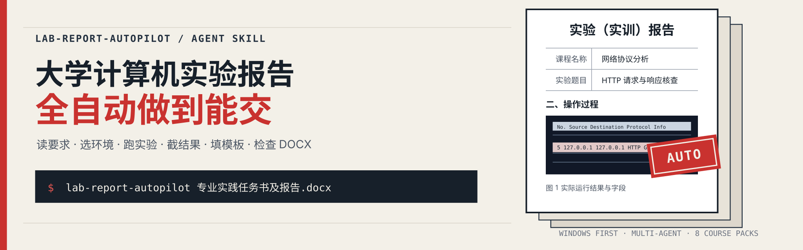
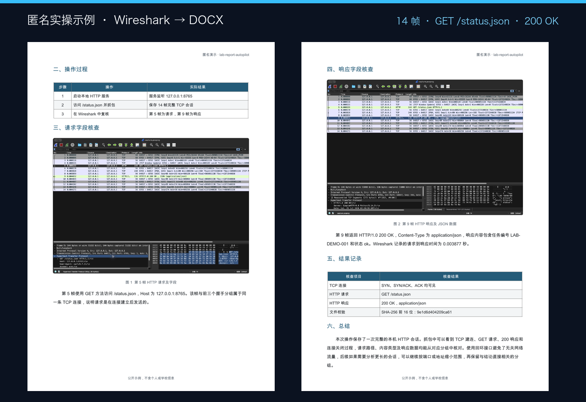
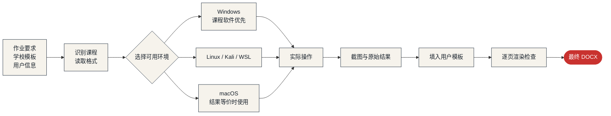

# lab-report-autopilot

> 把作业要求、学校模板和需要填写的信息交给 Agent。实验、截图、正文、排版和最终 DOCX 由它接着做完。

[](https://agentskills.io/)
[](#windows-优先但不写死环境)
[](#支持的课程)
[](LICENSE)

[安装](#安装) · [怎么使用](#怎么使用) · [自动完成哪些步骤](#自动完成哪些步骤) · [电脑怎么被操作](#电脑怎么被操作) · [支持的课程](#支持的课程) · [仓库结构](#仓库结构)

很多大学计算机实验，操作十几分钟，截图、写步骤、贴 Word、调行距却能折腾半天。这个 Skill 让 Agent 从任务书开始接手：检查当前电脑，选择能运行的软件环境，完成实验，截下结果，再照学校模板交回 DOCX。

它会真的执行命令、代码和图形软件。报告里的窗口、字段、帧号、查询结果和程序输出来自同一次操作，不靠生成一张“看起来像做过”的截图。

仓库遵循 Agent Skills 目录结构，可装进 Claude Code、Codex、Cursor、GitHub Copilot、Gemini CLI、OpenCode 等支持 Skills 的 Agent。不需要为了“能点屏幕”换装某个特定 Agent：终端命令和应用脚本能完成大多数实验，Agent 自带 computer use 时再用它操作图形软件，见[电脑怎么被操作](#电脑怎么被操作)。



上图来自一次本机 HTTP 抓包：14 帧，`GET /status.json`，响应为 `200 OK`。两张 Wireshark 画面随后写入匿名报告并逐页检查。

## 安装

最省事的方式，是把仓库地址发给支持 Agent Skills 的 Agent：

```text
请安装并使用这个 Skill：
https://github.com/Fldicoahkiin/lab-report-autopilot
```

使用 [Skills CLI](https://github.com/vercel-labs/skills)：

```bash
npx skills add Fldicoahkiin/lab-report-autopilot -g
```

使用正在预览的 [GitHub CLI `gh skill`](https://cli.github.com/manual/gh_skill)：

```bash
gh skill install Fldicoahkiin/lab-report-autopilot lab-report-autopilot \
  --scope user \
  --agent universal
```

`universal` 可以换成 `claude-code`、`codex`、`cursor`、`github-copilot`、`gemini-cli` 等 [GitHub CLI 支持的 Agent ID](https://cli.github.com/manual/gh_skill_install)。

手动安装时，把仓库 clone 到当前 Agent 的用户级 Skills 目录即可。Windows 用户不用先处理 Python、`pip` 或 PATH；Skill 会先验证现有环境，再为当前报告建立隔离运行时。

## 怎么使用

直接把作业文件交给 Agent，并点名这个 Skill：

```text
使用 lab-report-autopilot 完成这份数据库实验。
严格沿用我提供的 DOCX 模板，实际运行 SQL 并截图。
姓名、学号、班级和指导教师只填写我给出的值。
完成后检查每一页，只交付最终 DOCX。
```

专业实践也可以直接说明工作方向和允许写入的信息：

```text
使用 lab-report-autopilot 完成专业实践报告。
实践内容按我提供的任务书和材料来写，需要演示的操作在本地环境完成。
不要补写我没有提供的单位、岗位、日期或个人信息。
```

## 先给 Agent 这些

| 输入 | 用来做什么 |
| --- | --- |
| 作业要求或任务书 | 确定实验内容、必答项、软件、日期和文件名 |
| 学校提供的 DOCX | 保留原有封面、表格、字体、行距、页码和签字栏 |
| 需要填写的信息 | 姓名、学号、班级、教师、单位、岗位、日期等，提供什么就填什么 |
| 参考报告 | 学习步骤详略、截图位置和总结长度，不复制别人的身份和结果 |
| 额外要求 | 指定 Windows、限制篇幅、隐藏信息、截图数量或提交格式 |

缺少必填信息时，Agent 会集中询问一次。没有提供的个人信息不会猜，教师签名、成绩和审核意见也不会自行填写。

## 自动完成哪些步骤



从收到文件到交付报告，Agent 会依次完成：

1. 区分模板、作业要求、参考报告和用户信息。
2. 把模板中的字数、章节、纸张、页边距、字体、字号、行距、缩进、表格和页码写入核对表。
3. 检查当前电脑、虚拟机、WSL、容器和已安装软件。
4. 选择课程要求允许的环境，运行实验并保存原始结果。
5. 截取能看清操作和结果的画面，核对截图之间的数据是否一致。
6. 按模板写入步骤、结果、截图、说明和长度适中的总结。
7. 渲染 DOCX，逐页处理错位、空白页、表格溢出、图片过小和字体缺失。

## 电脑怎么被操作

这个 Skill 不绑定某一个 Agent，也不要求为了“能点屏幕”去装别的 Agent。Agent 会按下面的顺序，选第一个能完成当前步骤的方式：

| 顺序 | 方式 | 哪些 Agent 能用 | 典型用途 |
| --- | --- | --- | --- |
| 1 | 终端命令（本机，或 SSH 到虚拟机） | 所有能跑终端的 Agent | 安装、配置、命令行实验、传文件 |
| 2 | 应用脚本 | 所有能跑终端的 Agent | macOS 用 AppleScript 控制 Word、终端、UTM；Windows 用 `vmrun` 在 VMware 虚拟机里执行脚本、取回文件，用 COM 控制 Word；Linux 虚拟机里用 xdotool 输入、ImageMagick 截窗口 |
| 3 | Agent 自带的 computer use | 自带此功能的 Agent | 没有脚本接口的图形软件 |
| 4 | 你已安装的桌面控制 MCP | 支持 MCP 的 Agent | 同上，Agent 没有自带功能时 |
| 5 | 请你点一下 | 任意 | 管理员授权、登录、验证码等不该自动处理的地方 |

两条已经实际跑通的链路：

- **macOS + UTM**：AppleScript 和 `utmctl` 创建、启动 Ubuntu 虚拟机，SSH 进去安装和运行实验，在虚拟机桌面里用 xdotool 输入命令、ImageMagick 截图，最后用 AppleScript 让 Word 核对页数并导出 PDF。
- **Windows + VMware Workstation**：从注册表找到 `vmrun`，`vmrun start` 启动虚拟机，`runScriptInGuest` 执行写好的 Bash 脚本，输出和截图写进虚拟机里的文件再用 `CopyFileFromGuestToHost` 取回，最后用 Word COM 核对页数并导出 PDF。虚拟机账号和密码由你提供，Agent 不会去猜。

两条链路都没有用到 computer use。下面是 2026 年 10 月核对的各家自带 computer use 情况，变化很快，以官方文档为准：

| Agent | 平台 | 说明 |
| --- | --- | --- |
| [Claude Code 桌面版](https://code.claude.com/docs/en/desktop) | macOS、Windows | 需要 Pro/Max，在设置里开启 |
| [Claude Code CLI](https://code.claude.com/docs/en/computer-use) | macOS | 在 `/mcp` 里启用 `computer-use` |
| [Codex（ChatGPT 桌面应用）](https://learn.chatgpt.com/docs/computer-use) | macOS、Windows | 安装 Computer Use 插件；不能操作终端，Windows 上会占用前台 |
| 其他 Agent | — | 通过第 1、2 种方式，或接入桌面控制 MCP |

你可以随时拒绝某个应用的控制权限，Agent 会改用终端和脚本继续。

## Windows 优先，但不写死环境

大部分中国大学计算机课程围绕 Windows 软件、Office 和厂商教学工具安排，因此 Windows 是主路线。Skill 不会假设每个人都和作者使用相同的电脑或虚拟机。

Windows 上不会直接相信系统里的 `python` 或 `pip`。如果 Agent 没有自带运行时，Skill 会先运行 PowerShell 引导脚本：能用的 Python 被放进当前任务的虚拟环境；找不到或无法运行时，先复用当前 Windows 用户已注册的 Python 3.12（例如之前的报告工作区装过的那个），仍然没有才下载经过哈希校验的 CPython，并装在报告工作区；python.org 连不上时改用 npmmirror 和华为云镜像，文件哈希必须一致。整个过程不需要管理员权限，也不修改 PATH、文件关联或全局包。

| 条件 | 选择 |
| --- | --- |
| 作业指定 Windows、PowerShell、CMD、SSMS、eNSP、Access、Visual Studio | 使用原生 Windows，或现有 Windows 虚拟机、远程实验机 |
| Linux 网络、安全或系统实验 | 使用 Linux、Kali、WSL、虚拟机或隔离容器 |
| Wireshark、Python、Java、MySQL、网页开发等跨平台任务 | 当前系统能得到相同结果和截图时直接运行 |
| 用户使用 macOS | 软件原生支持就本机完成，否则接入任意可用的 Windows/Linux 环境 |
| 没有课程要求的软件或系统 | 只暂停受影响的部分，说明缺少什么，不伪造成功画面 |

支持 Hyper-V、VMware、VirtualBox、UTM、Parallels、WSL、Docker 和授权远程实验机，不把某一种虚拟化软件写成默认答案。

Apple Silicon Mac 优先用 UTM：免费，能用 AppleScript 和 `utmctl` 脚本化；Parallels 也可以，但更重。Linux 实验用 ARM64 虚拟机（Ubuntu 的软件源要用 `ubuntu-ports` 镜像），Windows 软件用 Windows 11 ARM 虚拟机；eNSP 这类只能跑在 x86 上的软件，建议用学校机房或远程 Windows。

## 支持的课程

课程包只覆盖常见课程的截图和分析规则，不是支持范围的上限。没有课程包的课程，例如 SDN、操作系统、Linux 运维、云计算、软件测试，Agent 会先查作业手册、官方文档、发布说明和源码仓库，确认版本和 CPU 架构对得上再动手。

| 课程包 | 常见实验 |
| --- | --- |
| `packet-analysis` | Wireshark、tshark、ARP、ICMP、TCP、DNS、HTTP、PCAP |
| `routing-switching` | VLAN、路由、交换、ACL、NAT、eNSP、Packet Tracer |
| `security-operations` | Windows 日志、告警复核、异常连接、终端检查、本地靶场 |
| `databases` | SQL Server、MySQL、PostgreSQL、SQLite、表结构、查询、视图和过程 |
| `programming` | C/C++、Python、Java、数据结构、算法、编译和运行 |
| `data-visualization` | Excel、Power BI、Python 绘图、数据清洗和图表说明 |
| `web-development` | HTML、CSS、JavaScript、响应式页面、控制台和网络请求 |
| `computer-architecture` | 电路、CPU、寄存器、存储器、汇编和仿真波形 |

课程规则分别放在独立 reference 中。一次任务只读取相关课程，不把数据库的截图要求套到抓包实验里；课程名不在表里时，直接把课程名传给 `init_report.py --discipline`。

## 按你的模板和信息填写

- 学校模板优先。仓库里的 Markdown 只用于没有模板时建立工作目录。
- Agent 先把模板里的明示要求和实测样式登记到 `format-contract.md`，再填内容，不重新做一份“差不多”的表格。
- 成品会逐项回填实测值；最低字数按最终 DOCX 统计，字体、字号、行距、缩进、表格和页码按结构检查。
- 姓名、学号、班级、教师、单位、岗位和日期只使用用户提供或确认的值。
- 私人或工作材料按用户要求留在本地；需要隐藏的地址、姓名和文件信息会在截图和正文中处理。
- 文件名服从当前作业的提交规则，不沿用另一门课的命名方式。
- 代码只实现作业要求，不塞无用的异常处理、配置层和大段注释。

## 什么算完成

- 实验真的运行过，提交的代码、命令和截图来自这次运行。
- 截图能看清软件、目标、输入和结果，前后数据对得上。
- 报告写的是操作、结果和必要说明，不用空泛理论凑页数。
- DOCX 保留用户模板的格式，每一页都经过渲染检查。
- 安全实验只在本地、课程环境或其他已授权目标中进行。
- 环境确实缺失时说明情况，不把失败改写成成功。

## 仓库结构

```text
lab-report-autopilot/
├── assets/readme/                    # README 图片
├── skills/lab-report-autopilot/
│   ├── SKILL.md                      # Agent 执行入口
│   ├── agents/openai.yaml            # Agent 界面元数据
│   ├── assets/templates/             # 草稿与模板格式核对表
│   ├── references/
│   │   ├── disciplines.md            # 课程选择表
│   │   ├── discipline-*.md           # 八类常见课程规则
│   │   ├── environment-playbook.md   # Windows / Linux / macOS 路线
│   │   ├── evidence-and-screenshots.md
│   │   ├── user-data-and-privacy.md  # 用户信息与私人材料
│   │   ├── writing-and-code.md
│   │   └── docx-qa.md
│   ├── scripts/
│   │   ├── bootstrap_windows.ps1      # Windows 隔离运行时
│   │   ├── init_report.py
│   │   ├── probe_environment.py
│   │   └── evidence_manifest.py
│   └── requirements.txt
├── tests/
└── LICENSE
```

在虚拟环境里运行测试：

```bash
python3 -m venv .venv
.venv/bin/python -m pip install -r skills/lab-report-autopilot/requirements.txt
.venv/bin/python -m unittest discover -s tests
```

## 许可

[MIT](LICENSE) · Copyright 2026 Flacier
